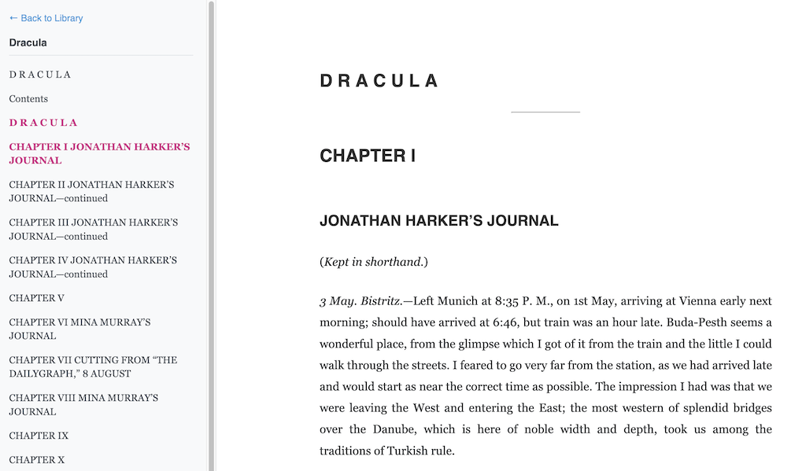

# reader 3



A lightweight, self-hosted EPUB reader that lets you read through EPUB books one chapter at a time. This makes it very easy to copy paste the contents of a chapter to an LLM, to read along. Basically - get epub books (e.g. [Project Gutenberg](https://www.gutenberg.org/) has many), open them up in this reader, copy paste text around to your favorite LLM, and read together and along.

This project was 90% vibe coded just to illustrate how one can very easily [read books together with LLMs](https://x.com/karpathy/status/1990577951671509438). I'm not going to support it in any way, it's provided here as is for other people's inspiration and I don't intend to improve it. Code is ephemeral now and libraries are over, ask your LLM to change it in whatever way you like.

## Usage

The project uses [uv](https://docs.astral.sh/uv/). So for example, download [Dracula EPUB3](https://www.gutenberg.org/ebooks/345) into the `library/` folder as `library/dracula.epub`, then:

```bash
uv run reader3.py dracula.epub          # or library/dracula.epub
```

Manage the library:

```bash
uv run reader3.py list                  # converted books
uv run reader3.py reprocess Dracula     # re-convert from library/Dracula.epub
uv run reader3.py reprocess --all       # e.g. after upgrading reader3
uv run reader3.py remove Dracula        # delete library/Dracula_data (keeps the .epub)
uv run reader3.py --help                # all commands (also --version)
```

This creates `library/dracula_data` next to the EPUB, which registers the book in the server's library. We can then run the server:

```bash
uv run server.py
```

And visit [localhost:8123](http://localhost:8123/) to see your current Library. Add more books with `reader3.py <file.epub>` and delete them with `reader3.py remove <name>`. It's not supposed to be complicated or complex.

After upgrading reader3, run `reprocess --all`; books converted by an older version are marked "outdated" until you do.

For safety, book content is sanitized and the server sends a strict Content-Security-Policy, so scripts and remote (http/https) images inside a book are not loaded; images embedded in the EPUB work normally.

### Reading

- Your place in each book is remembered (in the browser) and the library offers "Continue" for books you've started.
- Keyboard: `←` / `→` previous / next section, `t` show/hide the contents, `d` toggle dark mode, `f` switch serif / sans-serif, `+` / `-` text size.
- The A / A buttons (top right) change the text size and `Aa` switches the font; both choices are remembered.
- Dark mode follows your system setting until you pick one with the toggle.
- Use **Search this book** in the table of contents to find text across its sections. Select a result to jump to the section, highlight the match, and scroll it into view.
- The table of contents starts with a Cover link and includes section 2 by its title when the book's own TOC doesn't already link to it.

## Project layout

- `reader3.py` – command-line entry point (a thin wrapper around `converter/cli.py`).
- `converter/` – EPUB conversion: `convert.py` (pipeline), `sanitize.py`, `toc.py`, `images.py`, `slicing.py`, `metadata.py`, and `models.py` / `storage.py` (the on-disk book format).
- `server.py` – the web reader (FastAPI routes and security headers).
- `library.py` – finds, validates and caches the converted books in `library/`.
- `templates/` – Jinja pages; `static/` – their CSS and JavaScript (`theme.js` is shared by both pages).

## Tests

```bash
uv run pytest
```

The tests build small synthetic EPUBs, so they don't need any books in `library/`.

## License

MIT